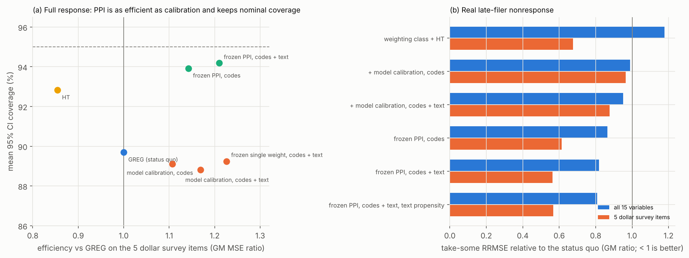

# Text embeddings as auxiliary variables: what we found, and where it points

**Scope.** This is a design-based Monte Carlo on a real finite population: New England non-profits, from IRS Form 990.
- The register is rebuilt as an agency would hold it on the design date.
- The survey is redrawn up to 2,000 times, with real late-filer nonresponse.
- It is a development population, so generalization is not yet assessed. Eight held-out Census divisions are reserved for that.
- The protocol (`notes/benchmark-protocol.md`) and every departure from it (`prereg/deviations.md`, D-1 to D-36) are in the repository.
- The analyses live in notebooks 01–06.

## Summary

**The claim as stated is mostly not supported.**
- With a production-grade register (lagged revenue, expenses, assets, employees, payroll and full activity codes), embeddings of mission and program text reduce the variance of survey-only estimates by about 4% (RE 1.044, 1.037–1.052).
- That is real: it survives random, permuted and constant-embedding controls and number masking.
- It is far below the 1.10 bar that would justify changing a production system.
- Stratification, small-area estimation and a register without tax data show no useful gain from text.

**The strongest result is about the estimator, not the embedding.**
- A **prediction-powered (difference) estimator with heads frozen from last cycle's respondents** gives two things production GREG does not:
  - it is 21% more efficient on the survey's dollar items (11% over all 10 survey-only variables);
  - it is the only ML-assisted estimator here with **valid confidence intervals**: 94% coverage and variance bias +3%. GREG and every calibration estimator cover 89–90%, and their variance estimates are 19–24% too small.
- Under **real nonresponse** the same estimator is the most robust option tested. Take-some RRMSE is 0.81× the status quo over all 15 variables, and 0.57× on the dollar items.
- Text is a genuine ingredient of it. The frozen text heads add about 4% efficiency under full response (RE 1.037) and about 11% under nonresponse (RE ≈ 1.11).

**Recommended direction: prediction-powered official statistics with frozen, previous-cycle models on rich unit descriptors.**
- The descriptors are register codes and text embeddings. The approach is evaluated design-based, with valid uncertainty.
- This reframes the idea from "embeddings as auxiliaries" to "how ML predictions enter estimation safely".
- It is directly relevant to uncertainty quantification in ML-enhanced inference.
- §5 has the ranked next steps.

---

## 1. The testbed

| Element | Choice | Real-world analogue |
|---|---|---|
| Population | 20,626 New England organizations filing a full Form 990 for TY2022 and TY2023 | A national non-profit survey population |
| Register on the design date D = 2024-06-30 | IRS BMF snapshot 2023-08-16 (every code and amount). The TY2022 return counts **only if filed by D**: 91.9% of units, but only 68.8% of revenue, because large organizations file late. | Business register plus prior-year tax data, as actually known at design time |
| Register tiers | F0: codes and BMF amounts · F1: + lagged revenue / expenses / assets / employees · **F1p: + payroll (primary)** · F2: + the full prior return | BR-only frames; BR + T2/GIFI; BR + PD7A; charities with T3010 |
| Design | NTEE10 (MISSING kept as a level) × 3 size classes + take-all top 1% (206 units); n = 1,000 | A production business-survey design |
| Targets (TY2023) | 10 headline variables **not on the F1p register**: gov. grants, contributions, program revenue, fundraising, officer compensation, volunteers, and four yes/no items. Four register-type controls. | Survey-only content |
| Text | TY2022 mission + program descriptions (median 71 words). E* = LSA (TF-IDF + SVD), 16 components, chosen on the previous wave by a pre-set rule. MiniLM as a second rung. | Registration "nature of business" text; T3010 program descriptions |
| Nonresponse | Real: a unit responds if its TY2023 return was filed within 300 days of year end. 61% of take-some units respond, 13.6% of take-all. | Late or missing questionnaires; large units the hardest |
| Replicates | R = 2,000 (calibration), 1,000 (weak register, nonresponse), 500 (small areas); common random numbers across all arms | — |

**Why the dataset can be trusted.** Notebook 01 runs about 45 checks. The main ones:
- Two independently written XML parsers agree on every target field.
- The 2023-08 BMF leaks target-year revenue for 0.48% of units, against 22.8% for a careless 2026 build.
- Text states the target value for ≤ 0.005% of units.
- Placebo targets gain nothing, and a memorization probe gives about 0.
- Leakage controls run inside every Monte Carlo:
  - design-date availability;
  - previous-wave BMF fields recomputed from lags;
  - a numbers-masked text arm;
  - grouped cross-fitting over near-duplicate texts (11.5% of units).

**Real register defects, kept on purpose:**
- NTEE missing for 31% of units;
- late filing by large units;
- heaped volunteer counts;
- 722 units (6.7% of expenses: Harvard, Tufts, Northeastern) with zero or missing BMF amounts.

---

## 2. The original claim, tested four ways

### 2.1 Calibration: real but small

| Comparison (GM-RE over the 10 headline variables) | RE | Reading |
|---|---|---|
| **P1:** text vs the same ML model on the full IRS code block | **1.044** (1.037–1.052) | Production bar (1.10) excluded; a gain exists |
| Text vs an ML model with NTEE10-level codes only | 1.086 (1.076–1.096) | Text substitutes partly for detailed codes |
| Random / permuted / within-stratum-permuted embeddings vs the same model | 0.993–0.999 | Controls behave. Text beats each by 1.045–1.051. |
| Numbers masked in the text | 1.044 | Gains are not from numbers in the text |
| MiniLM instead of LSA; 64 instead of 16 components | 1.023; 1.040 | A "better" embedding does **not** help |
| Text on salaries without / with payroll on the register | 1.028 → 1.002 | Payroll removes the only register-type gain |
| Text when the prior return's own lines are on the register (charity frame) | 1.015 over H; 1.001 on dollar items | Where the lag of y exists, text has nothing left to explain |

**Why it is small.** For a model-assisted estimator, RE ≈ 1/(1 − ρ²), where ρ² is the share of the residual variance
that text explains. RE 1.10 needs ρ² ≈ 0.09. Two facts keep ρ² low:
1. **The register already explains most of what is explainable.** Residuals are year-to-year changes and idiosyncratic amounts. A mission statement is static: 84.5% are unchanged between years. It describes *what kind* of organization a unit is, and the codes already partly say that.
2. **Heavy tails cap any unit-level covariate.** The variance is dominated by a few large units with idiosyncratic amounts. Even a *planted* text signal could not be made to explain more than a few percent of it on government grants (D-3).

**Where the gain comes from.**
- The ratio-scale ML learner with NTEE10-level codes is no better than GREG: 0.993.
- Text entered *linearly* is worse than GREG: 0.949. Text helps only through a ratio-scale model ("this kind of organization gets a large share of its budget from government").
- Within the ML learner, the full code block and text overlap. Text carries the larger Shapley share, 0.63 (0.58–0.68).
- The pre-registered 2³ attribution is not estimable: linear calibration on the full code block explodes in about 0.4% of replicates (D-32, D-33).

**Value to a real survey.** A multipurpose survey's sample size is set by its hardest target.
- Under the protocol's default national targets, the 1 pp standard-error target for the share with volunteers binds, and no estimator moves it. The saving is zero (an approximation using national targets only).
- If only the dollar totals had targets, government grants would bind. The best calibrated system would then save about 19% of the take-some sample, roughly 9 points of it from text.

### 2.2 Stratification: no gain

| Design change (GM-RE over all 15 variables) | HT | GREG | Rule |
|---|---|---|---|
| Fill the 31% missing NTEE codes with text-coded NTEE (63% accurate) | 0.997 | 1.017 | ≥ 1.05: **fail** |
| Strata split on a frozen text score (as pre-registered) | 0.709 (over H) | 0.767 (over H) | **A 23–29% loss**: the split costs size resolution |
| One more *size* class, for reference | 1.050 | 1.018 | — |

### 2.3 Small areas (66 state × NTEE10 domains): no gain

- Fay–Herriot with the text model vs the codes model:
  - mean domain RRMSE ratio 0.97 (has gov. grants) to 1.19 (gov. grants);
  - median domain about 0.97–0.98;
  - publishable domains +0 to +1.6 pp.
- The pre-registered bar was 0.90, so it **fails**. The FH used here is simpler than the protocol's (D-35), so read this as indicative.

### 2.4 Weak register (codes and BMF amounts, no tax data)

- **As pre-registered:** the design stratifies on BMF income. The register defect puts Harvard and Tufts in the bottom size class (weight 57), and nothing helps. Text RE 1.000.
- **With large-enterprise profiling** (a pre-declared sensitivity): text RE 1.035 (1.022–1.047), recovering 10–13% of what administrative lags give.
- Text is useful there for **workforce variables**: employees 1.14, salaries 1.11.
- The pre-registered bar of 1.20 is excluded in both variants.

**Verdict on the claim.** As a general-purpose variance-reduction tool for surveys with tax-linked registers, text
embeddings are worth about 4%. That falls short of the bar, and better embeddings do not change it.

---

## 3. The strong result: prediction-powered estimation with frozen heads

The idea:
- Train prediction heads (a ratio-scale ridge model on register codes, lagged size and optionally text) on **last cycle's respondents**.
- Freeze them, and predict y for every unit on this cycle's frame.
- Estimate with the difference form: t̂ = Σ_U m(x) + Σ_s d (y − m(x)).

This is prediction-powered inference (PPI) written as a survey difference estimator. Because m is fixed before the
sample is drawn, the estimator is exactly design-unbiased, and its variance is the ordinary design variance of the
residuals. No coefficient is estimated from the sample.

### 3.1 Full response: as efficient as the best calibration, with valid intervals

On the five dollar survey items (government grants, contributions, program revenue, fundraising, officer compensation):

| Estimator | Efficiency vs GREG | Mean CI coverage | Variance bias |
|---|---|---|---|
| GREG (status quo) | 1.00 | 89.7% | −19% |
| Model calibration, codes | 1.11 | 89.1% | −24% |
| Model calibration, codes + text | 1.17 | 88.8% | −24% |
| Frozen single weight, codes + text | 1.23 | 89.2% | −23% |
| **Frozen PPI, codes** | **1.14** | **93.9%** | **+3%** |
| **Frozen PPI, codes + text** | **1.21** (1.18–1.25) | **94.2%** | **+3%** |
| HT | 0.85 | 92.8% | +4% |

- Over all 10 survey-only variables, frozen PPI with text is 1.112 (1.094–1.129) against GREG. That meets the production bar. Text adds 1.037 (1.029–1.046) within PPI.
- Per variable: fundraising 1.70, contributions 1.21, government grants 1.18, program revenue 1.11; officer compensation 0.97; the yes/no items 0.98–1.07.
- **The uncertainty finding stands on its own.** In this skewed population every calibration estimator under-covers by 5–6 points. That includes the production GREG the agency would publish today. The cause is that the linearization variance treats the estimated calibration coefficients as fixed. The frozen difference estimator does not have that problem.
- **Limit.** PPI is the wrong tool for register-type variables: employees 0.27 and salaries 0.37 against GREG, because GREG calibrates to their lags exactly. The production design is therefore **per variable**: GREG for register-type totals, frozen PPI for survey content. A single weight set (the frozen single-weight arm) keeps the efficiency but loses the valid variance.

### 3.2 Real nonresponse: the most robust option tested

Late-filer nonresponse makes large units the least likely to respond. Calibrating to lagged size then *amplifies* the bias for
survey-only dollar items: government grants 4.5% → 14.8%, contributions 2.6% → 13.1%, fundraising 1.8% → 19.7%.

Plain weighting classes avoid that, but they are badly biased on size-related items: program revenue −20%, expenses
−15%, salaries −14%. No method wins everywhere. The frozen PPI estimator is the one that is never far off.

| Take-some RRMSE relative to the status quo (GM over variables) | All 15 | 5 dollar items |
|---|---|---|
| Weighting class + HT | 1.18 | 0.68 |
| + model calibration, codes / + text | 0.99 / 0.95 | 0.96 / 0.88 |
| Frozen PPI, codes | 0.86 | 0.61 |
| **Frozen PPI, codes + text** | **0.82** | **0.56** |
| Frozen PPI, codes + text, text in the propensity | **0.81** | 0.57 |

- Text helps in every form here, and more than under full response. Frozen PPI's RRMSE falls by 5% when text heads replace codes-only heads (RE ≈ 1.11). Under nonresponse, text helps predict the units that are *not* observed.
- **The problem is not solved.**
  - Government grants keep about 12% bias.
  - 6 of 15 variables cover below 85%.
  - The pre-registered S6 test fails against the least-biased text-free method (weighting-class HT on grants and contributions).
- The robustness ranking above was chosen after the results were seen (D-34). The per-variable comparisons were fixed beforehand.

---

## 4. Critical assessment

**Solid**
- The small size of the pure text effect (P1) is robust. It matches the pre-registered prediction, survives every control, and better embeddings do not move it.
- So is the calibration-amplifies-nonresponse-bias pattern, for three of the five survey-only dollar items. It is large, consistent across take-all scenarios, and has a clear mechanism.
- So is the coverage contrast between PPI and calibration estimators. It is consistent across variables and arms, and it matches the theory.

**Fragile, or not yet earned**
- **The PPI result emerged from secondary arms, not from a pre-registered primary.** It must be confirmed on the held-out divisions with PPI written in as a primary.
- **Strict pre-registered verdict: HARNESS NOT VALIDATED.** Four gates have failing items, all diagnosed:
  - G4 is the variance under-coverage of calibration estimators described above. It is the finding, not a text defect.
  - G3 is the unstable linear arms, plus a frozen single-weight placebo effect.
  - G6: the learner realizes only 20–34% of a planted text signal at n = 1,000, so a null can never be "falsified" with this design.
  - G2: noise embeddings "help" officer compensation by 1.5–2.3%.
- One development population. 990 text is richer than Canadian business-registration text. The register lags and targets come from the same form. All three favour text.
- "Pre-registered" means committed before results; there was no formal sign-off (D-36).

---

## 5. Where to take it (ranked)

1. **Confirm prediction-powered estimation at national scale.**
   - Pre-register frozen PPI (codes, and codes + text) against GREG as the primary on the 8 held-out divisions (285k units).
   - Add a bootstrap variance for every arm.
   - Add a *power-tuned* PPI that mixes calibration and difference estimation per variable (PPI++ style), to keep GREG's exactness on register totals and PPI's valid variance on survey content.
   - Everything needed is public. This is the decisive experiment.
2. **Nonresponse with frozen models.** It is the largest error source found here, and the place where text matters most.
   - Doubly robust estimators with frozen outcome heads and better response models.
   - MNAR sensitivity analysis.
   - A take-all strategy: 86% of take-all units are imputed under real timing, and that error is in no variance estimate.
3. **Richer descriptors where registers are thin or content is not financial.**
   - Cohere multimodal embeddings of prior-year financial statements, against *extracting the numbers* from the same PDFs (UK Charity Commission).
   - Website text for ICT-type items.
   - A Canadian replication on T3010 data (bilingual text).
   - All three need network access the cloud sandbox lacks. That is one reason to move locally (`LOCAL_SETUP.md`).
4. **A contribution to UQ for ML-enhanced inference.** The coverage contrast (calibration under-covers, frozen PPI does not) is a clean, design-based case study for the UNECE handbook, and it is relevant to agencies whatever happens with text.
5. **A paper**: "Prediction-powered estimation for official business statistics: a design-based evaluation with real nonresponse". The testbed (design-date register, real nonresponse, leakage controls, pre-registration) is itself reusable.

What **not** to pursue:
- text-based stratification;
- text as a Fay–Herriot covariate;
- larger or "better" text-only embedding models for financial targets.

---

## 6. Which real data would play the role of the text

| Source | Coverage | Confidentiality | Best role, given these results |
|---|---|---|---|
| Admin tax and payroll lines (T2/GIFI, T3010 lines, PD7A) | Near-universal | Confidential | **Link them first.** The prior return's own lines are worth 1.3–5.5× per variable at the design date (gov. grants 4.6, fundraising 5.5), against text's 1.04. |
| Full activity / organization codes on the register | Universal | Confidential | Feed them to a ratio-scale model. They overlap with text: Shapley share 0.37 within the ML learner, about 0.6 if codes come first. |
| BN registration "major business activity" text | Near-universal, stale for old units | Confidential: on-prem models only | A feature in frozen prediction heads; autocoding missing activity codes for classification. Shorter than 990 text, so expect less. |
| T3010 program descriptions | About 84k charities | Public | A Canadian replication. Charity frames already carry the prior return, so text has little left to explain. |
| Websites | Size-graded (about half of small units) | Public, under the web-scraping policy | Non-financial survey content (services, e-commerce, AI use) |
| Annual reports / financial-statement PDFs | Mostly larger units | Public in UK / AU | Where Cohere's multimodal model applies, but extract the numbers first: they *are* the lag of y |

**Governance.**
- BN/BR text cannot go to a SaaS API, and none of Cohere's managed options documents Canadian processing. Use on-prem models: LSA and MiniLM were used here, and LSA was the better of the two.
- Freeze models per cycle, content-address the embeddings, and run a bridging study on model deprecation.

---

## 7. Scorecard against the pre-registered hypotheses

| ID | Result | Status |
|---|---|---|
| P1 text vs ML twin | 1.044 (1.037–1.052) | Production bar EXCLUDED; any gain YES |
| P2 frozen system vs GREG | 1.121 (1.108–1.134); no harm | Efficiency MET; validity gate G4 fails (shared with GREG) |
| H7 payroll removes the salaries gain | 1.028 → 1.002 | Supported |
| S-F2 text adds with the full prior return | 1.029 (H_S), 1.001 (H_D) | Fail |
| S2 / S2b weak register | 1.000 (as specified) / 1.035 (profiled); gap closure 0.00 / 0.10 | Fail |
| S4 text-coded NTEE in the design | 0.997 (HT), 1.017 (GREG) | Fail |
| S5 prediction strata | 0.71–0.77 | Excluded (a loss) |
| S6 text reduces nonresponse bias against the least-biased method | BRF < 0 for all 5 variables | Fail |
| S7 small areas | 0.97–1.19 | Fail (simplified FH, D-35) |
| S9 a modern embedding is needed | MiniLM 1.023 < LSA 1.044 (Cohere not run) | Fail on the rung tested |
| M1 text is the main source of the gain | 0.63 (0.58–0.68) within the ML learner; 2³ not estimable | Pass, conditionally |
| M5 planted-signal recovery | φ = 0.20–0.34; ρ²_min does not exist | Falsification unreachable |
| M6 frozen per-variable calibration keeps ≥ 75% of the gain | 0.73 | Fail (narrowly) |
| H14 a single weight keeps the gain | 1.19 of P1's log gain | Pass |

---

## 8. Running it locally, and what I need from you

- **Local move.** `LOCAL_SETUP.md` and `scripts/reproduce_ne.sh` rebuild everything from the public data lake with the same seeds. The best moment is before the national build: it is the largest CPU job, and it needs persistent storage and network access the cloud sandbox lacks.
- **Decisions only you can make:**
  - promote frozen PPI to a pre-registered primary for the divisions, and sign off (U9);
  - real CV targets for the binding-constraint calculation (U5);
  - a Cohere production key and the T3010 / Charity Commission data (U1, U2, U3), which become easy locally.
- **Detail** is in `notebooks/03`–`06` (with outputs), `prereg/deviations.md` and `notes/working-log.md`. The pilot notes (`notes/early-findings.md`) are superseded.
